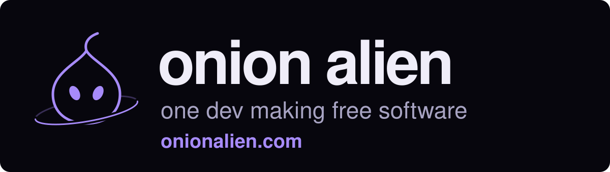

<a href="https://onionalien.com">
  <picture>
    <source media="(prefers-color-scheme: light)" srcset="./assets/header-light.svg" />
    
  </picture>
</a>

**[Onion Board](https://github.com/Onion-Alien/onion-board)**: a soundboard for Discord and games. It plays through the mic you already use, so there's no virtual cable to set up.

**[Onion Watch](https://github.com/Onion-Alien/onion-watch)**: plays a sound when something shows up in your game, even while you're alt-tabbed.

**[Onion Launcher](https://github.com/Onion-Alien/onion-launcher)**: your apps, one key away. Press Win + ` and a small box of your favourite apps pops up next to the mouse.

**[Onion Pocket](https://github.com/Onion-Alien/onion-pocket)**: your Onion Board pads on your phone. Scan the QR code and tap.

**[Onion Peel](https://github.com/Onion-Alien/onion-peel)**: peel a piece off your screen. Press Win + Shift + S, pick an area, and it's on the clipboard. No window, no history, no network.

They're free. Download them at **[onionalien.com](https://onionalien.com)** (Onion Peel: from its [releases page](https://github.com/Onion-Alien/onion-peel/releases/latest)).
