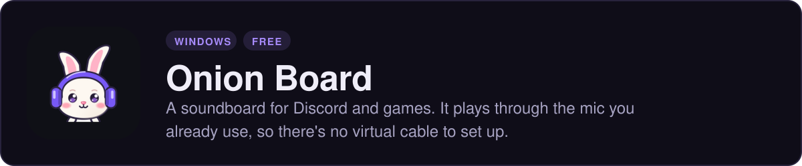
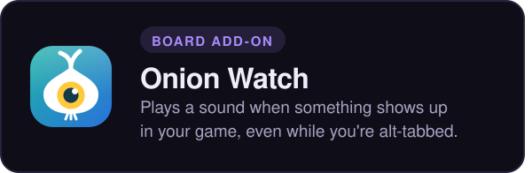
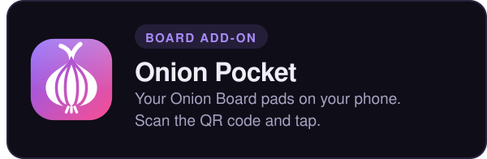
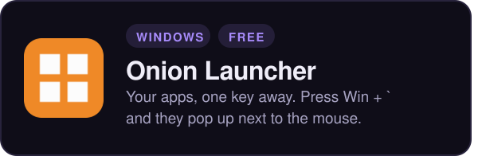
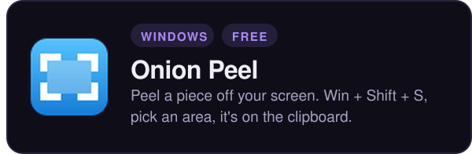

<a href="https://github.com/Onion-Alien/onion-board"><picture><source media="(prefers-color-scheme: light)" srcset="./assets/board-light.svg" /></picture></a>

<a href="https://github.com/Onion-Alien/onion-watch"><picture><source media="(prefers-color-scheme: light)" srcset="./assets/watch-light.svg" /></picture></a><a href="https://github.com/Onion-Alien/onion-pocket"><picture><source media="(prefers-color-scheme: light)" srcset="./assets/pocket-light.svg" /></picture></a>

<picture><source media="(prefers-color-scheme: light)" srcset="./assets/label-apps-light.svg" /></picture>

<a href="https://github.com/Onion-Alien/onion-launcher"><picture><source media="(prefers-color-scheme: light)" srcset="./assets/launcher-light.svg" /></picture></a><a href="https://github.com/Onion-Alien/onion-peel"><picture><source media="(prefers-color-scheme: light)" srcset="./assets/peel-light.svg" /></picture></a>

They're all free. Download them at **[onionalien.com](https://onionalien.com)**.
